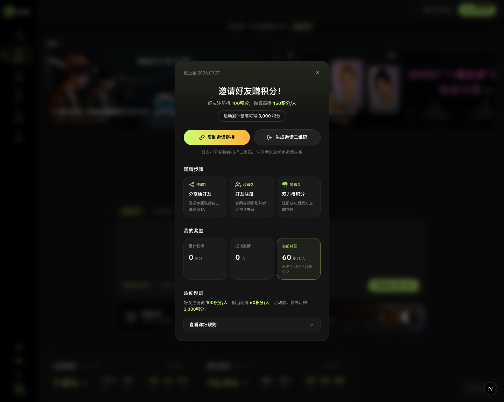
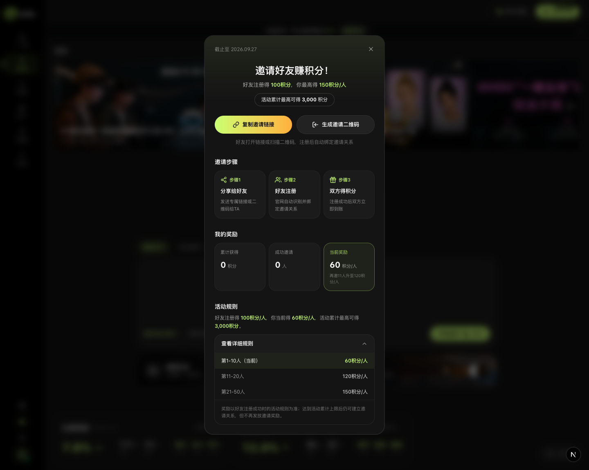
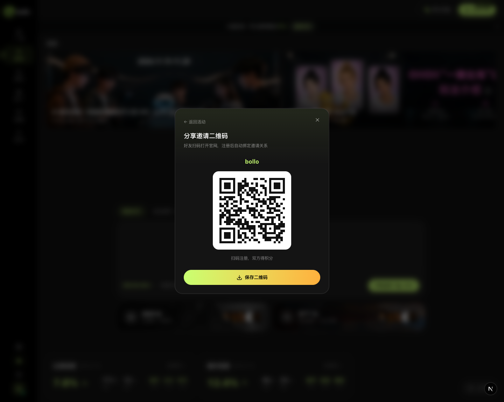
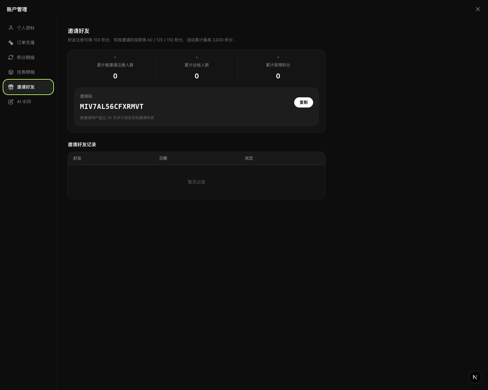
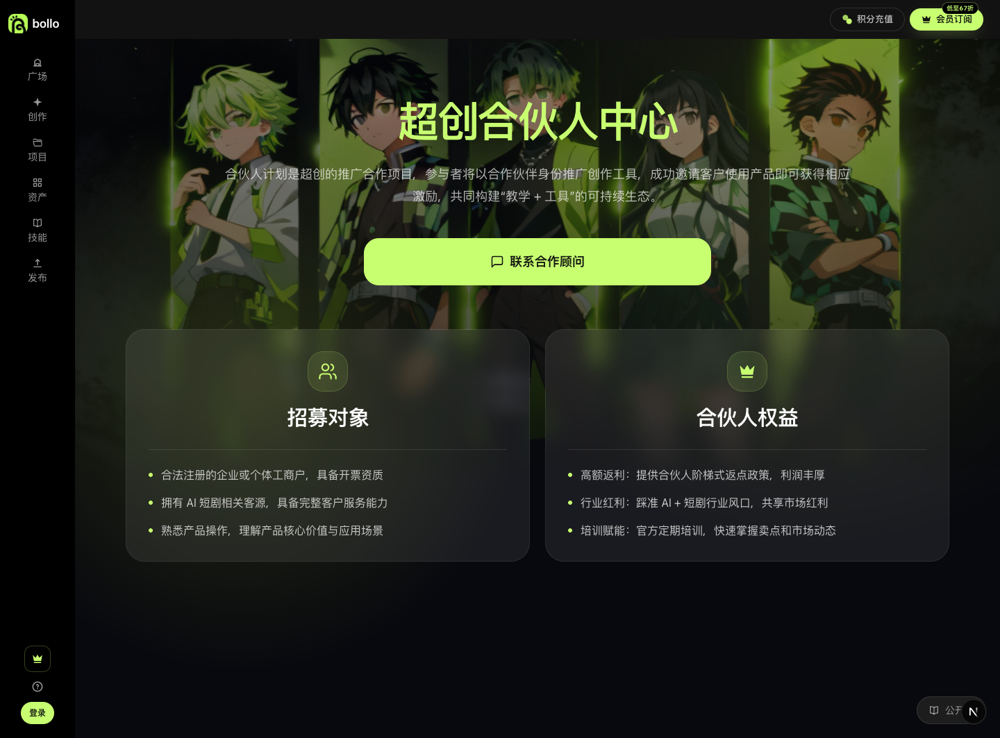
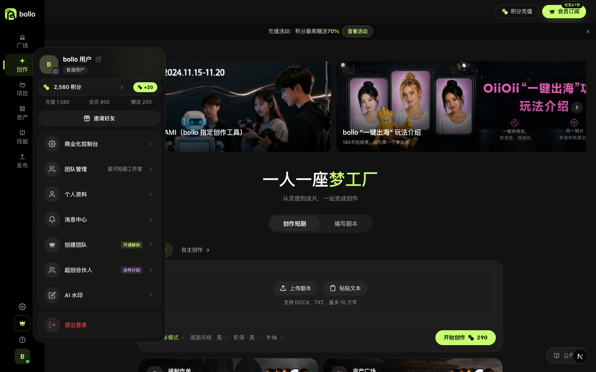
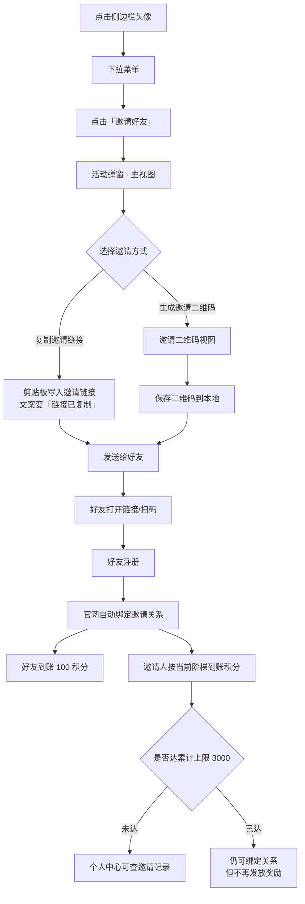
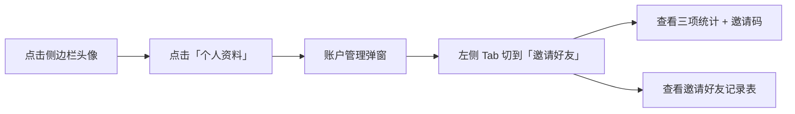

# 邀请好友赚积分活动 · 需求文档

| 项目 | 内容 |
|------|------|
| 文档名称 | 阶梯式推荐奖励活动（邀请好友赚积分）需求文档 |
| 版本 | v1.0 |
| 更新日期 | 2026-09-28 |
| 需求来源 | `CHANGELOG-2026.05-2026.09.md` → 团队、账号与增长 → 「阶梯式推荐奖励活动（9月）」 |
| 现有实现 | `src/components/invite-campaign-dialog.tsx`、`src/components/account-dialog.tsx`（InviteTab）、`src/app/partner/page.tsx` |
| 截图目录 | `docs/design-references/invite-campaign/` |

---

## 一、背景与目标

### 1.1 背景

现有邀请机制只有「复制邀请码」这一条静态路径，缺少激励梯度与进度反馈，用户分享意愿弱、可感知的收益上限模糊。参考 changelog 要求，本期落地**阶梯式推荐奖励活动**：把「邀请人数」与「单人奖励积分」绑定为阶梯，用进度可视化推动用户持续邀请。

### 1.2 目标

| 目标 | 衡量方式 |
|------|----------|
| 提升邀请转化 | 邀请链接/二维码的复制、保存、分享次数 |
| 提升人均邀请人数 | 人均成功邀请注册人数 |
| 降低理解成本 | 活动规则区「查看详细规则」展开率 |

### 1.3 范围

**包含**：活动弹窗（活动主视图 / 规则明细 / 邀请二维码）、个人中心「邀请好友」子页（邀请码 + 邀请记录）、与「超创合伙人中心」的入口区隔。

**不包含**：合伙人（B 端返佣）结算体系、提现流程、团队席位邀请。

---

## 二、奖励规则（核心）

### 2.1 阶梯表

| 邀请人数区间 | 你的奖励（积分/人） | 区间人数 | 区间理论收益 |
|--------------|--------------------|---------|-------------|
| 第 1–10 人（起始档） | 60 | 10 | 600 |
| 第 11–20 人 | 120 | 10 | 1,200 |
| 第 21–50 人 | 150 | 30 | 4,500 |

### 2.2 双向奖励

- **好友侧**：注册成功即得 **100 积分**（不随阶梯变化）
- **邀请人侧**：按上表阶梯获得 **60 / 120 / 150 积分/人**
- **活动累计上限**：**3,000 积分**（硬上限）

### 2.3 关键约束

1. **奖励以「好友注册成功那一刻」的活动规则为准**，后续规则调整不追溯。
2. **达到累计上限后仍可建立邀请关系，但不再发放邀请奖励。**
3. **邀请失效规则**：被邀请用户超过 **30 天**未订阅会员则邀请失效（当前仅在个人中心展示）。
4. 邀请关系由官网在注册时**自动识别并绑定**，链路为 `https://bollo.ai/i/<邀请码>`。

> ⚠️ **待确认的规则矛盾**（见第八节 Q1/Q2）：阶梯上限收益合计为 6,300 积分，与 3,000 上限冲突；档位人数分布 10/10/30 不均匀。

---

## 三、功能说明（含截图）

### F1 活动弹窗 · 活动主视图



| 区域 | 元素 | 说明 |
|------|------|------|
| 顶部 | 截止日期 | `截止至 2026.09.27`，活动过期后弹窗应停止投放 |
| 顶部 | 关闭按钮 | 右上角圆形按钮，`aria-label="关闭"` |
| 标题区 | 主标题 | 「邀请好友赚积分！」 |
| 标题区 | 副标题 | 「好友注册得 **100积分**，你最高得 **150积分/人**」，数字用品牌色高亮 |
| 标题区 | 上限胶囊 | 「活动累计最高可得 3,000 积分」 |
| CTA 区 | 复制邀请链接 | 品牌色渐变主按钮；点击后文案变「链接已复制」，2 秒后复原 |
| CTA 区 | 生成邀请二维码 | 次级按钮，进入 F3 二维码视图 |
| CTA 区 | 说明文案 | 「好友打开链接或扫描二维码，注册后自动绑定邀请关系」 |
| 邀请步骤 | 3 步卡片 | ①分享给好友 → ②好友注册 → ③双方得积分 |
| 我的奖励 | 累计获得 | 单位「积分」，累计口径 |
| 我的奖励 | 成功邀请 | 单位「人」，累计口径 |
| 我的奖励 | 当前奖励 | 品牌色描边高亮卡，展示当前档位单人积分 + 升档提示（如「再邀11人升至120积分/人」） |
| 活动规则 | 规则摘要 | 一句话说明双向奖励与上限 |
| 活动规则 | 查看详细规则 | 折叠开关，`aria-expanded` 同步 |

**交互要求**

- 复制链接失败（如剪贴板权限被拒）静默降级，不阻塞用户，但不得抛出未捕获异常。
- 「当前奖励」卡片必须反映**实时档位**，不得硬编码。
- 升档提示文案需按剩余人数计算（当前实现为硬编码，见第八节 Q3）。

### F2 活动弹窗 · 规则明细（展开态）



| 元素 | 说明 |
|------|------|
| 阶梯行 | 逐行展示「人数区间 / 单人奖励」，当前档位行用品牌色底 + 品牌色数字高亮 |
| 免责说明 | 「奖励以好友注册成功时的活动规则为准；达到活动累计上限后仍可建立邀请关系，但不再发放邀请奖励。」 |

### F3 活动弹窗 · 邀请二维码



| 区域 | 元素 | 说明 |
|------|------|------|
| 顶部 | 返回活动 | 「← 返回活动」回到 F1，不关闭弹窗 |
| 标题 | 分享邀请二维码 | 副标题「好友扫码打开官网，注册后自动绑定邀请关系」 |
| 主体 | 品牌标识 + 二维码 | `bollo` 文字标识 + 白底二维码（纠错级别 M，深色 `#111111`） |
| 主体 | 扫码提示 | 「扫码注册，双方得积分」 |
| 底部 | 保存二维码 | 触发浏览器下载 `bollo-invite-qrcode.png`，文案短暂变「已保存」 |

**异常处理**：二维码生成中需有占位态（`role="status"`，文案「二维码生成中…」）；生成失败时按钮不可用，不允许点击后无响应。

### F4 个人中心 · 邀请好友子页



| 区域 | 元素 | 说明 |
|------|------|------|
| 说明 | 规则摘要 | 「好友注册可得 100 积分，你按邀请阶段获得 60 / 120 / 150 积分，活动累计最高 3,000 积分。」 |
| 统计 | 三项指标 | 累计被邀请注册人数 / 累计达标人数 / 累计获得积分 |
| 邀请码 | 邀请码 + 复制 | 等宽字体展示，如 `MIV7AL56CFXRMVT`；点击「复制」后文案变「已复制」 |
| 邀请码 | 失效提示 | 「被邀请用户超过 30 天未订阅会员则邀请失效」 |
| 记录 | 邀请好友记录表 | 列：好友 / 日期 / 状态；空态显示「暂无记录」 |

### F5 关联功能 · 超创合伙人中心（B 端，入口区隔）



- 面向**企业/个体工商户**的推广返佣计划，与 C 端「邀请赚积分」是两条独立链路。
- 入口位于头像下拉菜单「超创合伙人」（带「合作计划」标签），跳转 `/partner`。
- 权益为「合伙人阶梯式返点政策」，非积分奖励，不占用 C 端活动上限。

### F6 入口 · 头像下拉菜单



- 「邀请好友」为独立胶囊按钮，置于积分卡片与核心菜单之间，是**唯一直达活动弹窗**的入口。
- 点击后先关闭下拉菜单，再打开活动弹窗，避免层级叠加。

---

## 四、操作流程

### 4.1 邀请人主流程



### 4.2 查看进度流程



### 4.3 升档时序（示例：从 0 人邀到第 11 人）

| 步骤 | 触发 | 邀请人数 | 单人奖励 | 累计积分 |
|------|------|---------|---------|---------|
| 1 | 初始 | 0 | 60 | 0 |
| 2 | 第 10 人注册成功 | 10 | 60 | 600 |
| 3 | 第 11 人注册成功 | 11 | **120**（升档生效） | 720 |

> 升档在**跨越边界的那一次注册**即对当次生效，不做区间拆分结算。

---

## 五、页面元素与文案对照

| 位置 | 文案 | 数据来源 |
|------|------|---------|
| 活动弹窗顶部 | 截止至 2026.09.27 | 活动配置 `endAt` |
| 活动弹窗副标题 | 好友注册得 100积分，你最高得 150积分/人 | 活动配置 `inviteeReward` / 阶梯最高档 |
| 活动弹窗胶囊 | 活动累计最高可得 3,000 积分 | 活动配置 `totalCap` |
| 我的奖励 · 当前奖励 | 60 积分/人 + 再邀11人升至120积分/人 | 进度接口 `currentTier` + `nextTier` |
| 规则明细 · 免责 | 奖励以好友注册成功时的活动规则为准…… | 静态文案 |
| 个人中心 · 邀请码 | MIV7AL56CFXRMVT | 用户邀请码 |
| 个人中心 · 失效提示 | 被邀请用户超过 30 天未订阅会员则邀请失效 | 活动配置 `expireDays` |
| 邀请链接 | https://bollo.ai/i/MIV7AL56CFXRMVT | `baseUrl + /i/ + code` |

---

## 六、接口设计建议

changelog 明确要求拆分**活动 / 进度 / 规则**三类 API，当前前端为纯本地硬编码，接入服务端时按下列契约替换：

### 6.1 活动信息

```http
GET /api/referral/campaign
```

```json
{
  "id": "cmp_2026q3_invite",
  "title": "邀请好友赚积分！",
  "status": "active",
  "startAt": "2026-08-01T00:00:00+08:00",
  "endAt": "2026-09-27T23:59:59+08:00",
  "inviteeReward": 100,
  "totalCap": 3000,
  "expireDays": 30,
  "inviteBaseUrl": "https://bollo.ai/i/"
}
```

### 6.2 奖励规则（阶梯）

```http
GET /api/referral/rules
```

```json
{
  "tiers": [
    { "min": 1,  "max": 10, "reward": 60  },
    { "min": 11, "max": 20, "reward": 120 },
    { "min": 21, "max": 50, "reward": 150 }
  ]
}
```

### 6.3 我的进度

```http
GET /api/referral/progress
```

```json
{
  "code": "MIV7AL56CFXRMVT",
  "link": "https://bollo.ai/i/MIV7AL56CFXRMVT",
  "invitedCount": 0,
  "qualifiedCount": 0,
  "earnedPoints": 0,
  "currentTier": { "min": 1, "max": 10, "reward": 60 },
  "nextTier": { "min": 11, "max": 20, "reward": 120 },
  "remainingToNextTier": 11,
  "capReached": false
}
```

### 6.4 邀请记录（分页）

```http
GET /api/referral/invites?page=1&pageSize=20
```

```json
{
  "items": [
    { "nickname": "用户***", "phone": "138****8000", "registeredAt": "2026-09-20T10:12:00+08:00", "status": "qualified", "reward": 60 }
  ],
  "total": 0,
  "page": 1
}
```

> `status` 枚举：`pending`（已注册未达标）/ `qualified`（达标已发奖）/ `expired`（超 30 天未订阅失效）。

---

## 七、异常与边界

| 场景 | 期望行为 |
|------|---------|
| 活动已结束 | 不投放弹窗；若用户已打开则展示结束态并隐藏 CTA |
| 未登录用户 | 入口不可见（入口位于已登录的头像下拉内），不出现「无邀请码」空态 |
| 剪贴板写入失败 | 静默降级，不阻塞；建议降级为提示用户手动复制 |
| 二维码生成失败 | 按钮置为不可用 + 文案提示，不得点击无响应 |
| 达到累计上限 | 仍可复制链接/生成二维码；「当前奖励」显示已达上限，不再展示升档提示 |
| 邀请记录为空 | 表格空态「暂无记录」 |
| 移动端窄屏 | 弹窗宽度自适应，`max-h` 受视口约束并可内部滚动 |

---

## 八、待确认问题（Open Questions）

| 编号 | 问题 | 现状 | 影响 |
|------|------|------|------|
| Q1 | 阶梯理论上限收益为 600 + 1,200 + 4,500 = **6,300 积分**，与「累计最高 3,000 积分」冲突 | 两处文案同屏出现，用户可自行加总发现矛盾 | 规则可信度；建议改为「上限 3,000」并在阶梯表中标注实际可达成区间（约在**第 28 人**触顶） |
| Q2 | 档位人数分布为 10 / 10 / 30，跨度极不均匀 | 第 21–50 档位因上限约束实际无法完整兑现 | 建议收敛为 10/10/10 或与上限对齐 |
| Q3 | 升档提示「再邀11人升至120积分/人」为**硬编码** | 邀请 5 人时仍显示「再邀11人」 | 进度误导；应改为 `nextTier.min - invitedCount` 动态计算 |
| Q4 | 「30 天未订阅会员则邀请失效」仅出现在个人中心，活动弹窗未提及 | 规则披露不完整 | 合规与客诉风险；建议活动弹窗规则区同步 |
| Q5 | `qualifiedCount`（累计达标人数）口径未定义 | 仅展示占位 0 | 需明确「达标」= 完成注册 还是 完成订阅 |
| Q6 | 活动弹窗与个人中心子页的统计口径是否一致 | 弹窗用「累计获得/成功邀请」，个人中心用「累计被邀请注册人数/累计达标人数/累计获得积分」 | 同指标不同命名易混淆；建议统一术语 |
| Q7 | 头像下拉「超创合伙人」标签使用紫色 `#d8a8ff`，与品牌色规范不一致 | 项目规范要求主色统一为品牌色 | 视觉一致性；建议改用品牌色或改为中性标签 |

---

## 九、当前实现状态

| 模块 | 状态 | 文件 |
|------|------|------|
| 活动弹窗（主视图 / 规则 / 二维码） | ✅ 已完成（前端，数据硬编码） | `src/components/invite-campaign-dialog.tsx` |
| 个人中心「邀请好友」子页 | ✅ 已完成（静态数据） | `src/components/account-dialog.tsx`（`InviteTab`） |
| 入口接入（头像下拉 → 弹窗） | ✅ 已完成 | `src/components/account-dropdown.tsx`、`src/components/layout/sidebar.tsx` |
| 合伙人中心（B 端入口区隔） | ✅ 已完成 | `src/app/partner/page.tsx` |
| 活动 / 进度 / 规则 API | ❌ 未接入 | 需新增 `src/app/api/referral/*` |
| 邀请记录落库与分页 | ❌ 未接入 | 当前为空态占位 |
| 邀请关系绑定与发奖 | ❌ 未接入 | 依赖注册链路 |

---

## 附：截图清单

| 文件 | 内容 |
|------|------|
| `01-entry-dropdown.png` | 头像下拉菜单「邀请好友」入口 |
| `02-dialog-main.png` | 活动弹窗 · 主视图 |
| `03-dialog-rules.png` | 活动弹窗 · 规则明细（展开） |
| `04-dialog-qr.png` | 活动弹窗 · 邀请二维码视图 |
| `06-account-invite-tab.png` | 个人中心 · 邀请好友子页 |
| `07-partner-page.png` | 超创合伙人中心（B 端关联页面） |
